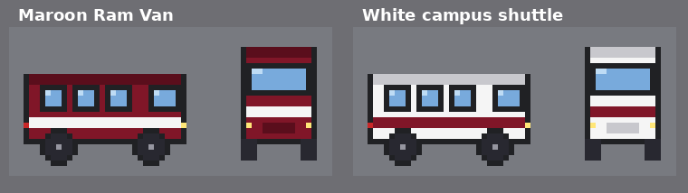
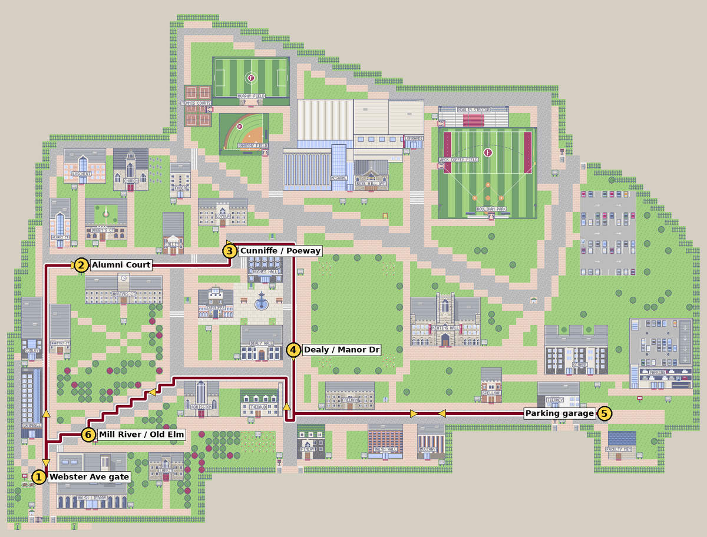
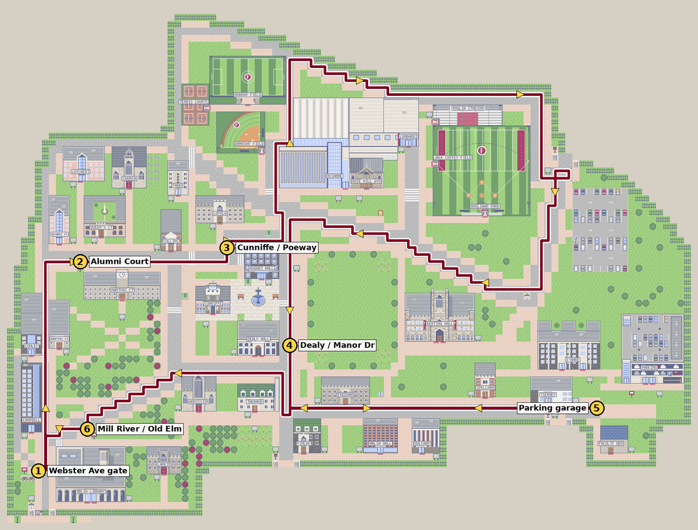

# D-0044: A shuttle that drives around campus

| | |
|---|---|
| **Status** | Decided: all five parts approved as recommended (B; B with one shuttle; Part 3; B with "next shuttle" times; Part 5) |
| **Raised** | 2026-10-14. A Ram shuttle that drives around campus on the roads |
| **Affects** | The roads and the six shuttle-stop signs on the map, a new vehicle, the First Week Checklist, the shuttle's card in the game and the Campus Guide |
| **Built?** | Yes, on branch `campus-shuttle` (from `mobile`). See "What was built" at the end |

## What's there today

- **Roads.** The gray roads already join up into one network, from the Webster Avenue gate in the southwest, around the athletic fields in the north, to Matteo Ricci Circle at the Main Entrance and Clavius Way in the southeast. Nothing drives on them yet. People who wander (D-0040) already stay off them.
- **Six shuttle-stop signs** (maroon bus signs) are already on the map:
  1. by the Webster Avenue gate
  2. at the Alumni Court circle
  3. on Edgar Allan Poeway by Cunniffe House
  4. on Rose Hill Manor Drive by Dealy Hall
  5. by the Fordham Regional Parking Facility
  6. on Mill River Road at Old Elm Road
- **The Orientation Leader** already says the gray roads are "for the Ram Van shuttle and service vehicles, so stick to the sidewalks and cross at the striped crosswalks."
- **The Main Entrance officer** already says "Cars, the Ram Van and visitors come in here."
- **The intro** shows a maroon Fordham Ram Van outside the station.
- **The First Week Checklist** has a step: read a Ram Van stop's sign.

## What we know about the real campus

Fordham seems to run **two different services**, and the game's stop card mixes them up:

| | **Ram Van** | **On-campus shuttle** |
|---|---|---|
| What it does | Runs between Rose Hill and Lincoln Center | Loops around Rose Hill, with stops in front of most buildings |
| Where you catch it at Rose Hill | The Ram Van office, ground level of the parking garage across from O'Hare Hall | The campus stops |
| Run by | Fordham Transportation | Public Safety, with student drivers (since 2010) |
| Vehicle | Van (not described) | A white Honda or Toyota minivan with a Fordham logo |
| When | Early morning until midnight or later; times vary by season | Weekdays, about 7:30 a.m. to 7 p.m. |
| Cost / booking | $3.50 one way, or 12 trips for $35. Seats can be reserved up to 48 hours ahead | Free |
| Tracking | Not mentioned | The TransLoc app (choose "Fordham University") |
| Access | Not mentioned | Not wheelchair accessible, according to a university spokesperson (2025) |

The official campus map marks the campus stops as Ram Van / shuttle stops, so students may well call both "the Ram Van". Some of this is from a 2025 student newspaper article, so **names, stops, hours and prices need confirming with Fordham** before launch.

---

# Part 1: Which vehicle drives around campus

### A. A maroon "Ram Van" loops campus
- It matches what you asked for and the van in the intro.
- But the real Ram Van goes to Lincoln Center rather than looping campus, so the game would teach something slightly wrong.

### B. A white "Campus Shuttle" loops campus, and the Ram Van waits at the garage (recommended)
- **The Campus Shuttle**, a white minivan with a maroon stripe like the real one, drives the loop and stops at the six signs.
- **A maroon Ram Van** stays parked at the garage stop. Its driver tells you about the Lincoln Center service: where to catch it, tickets and reservations.
- This keeps the game accurate, and players learn both services.
- If Fordham says the campus loop really is called the Ram Van, it's a one-line change to the name and colour.

### C. Both drive
- The Campus Shuttle loops, as in B.
- Every few minutes the maroon Ram Van leaves the garage, drives out the Main Entrance "to Lincoln Center", and comes back later.
- It's the most lively, but it's twice the driving and art work. I'd add it later if you like B.

Rough mock-ups of the two vans (side and front views; final art would follow the house style, D-0021):

## Your decision (Part 1)

- [x] **Approve**: B
- [ ] **Not approve**: say which option you'd prefer (A or C)
- [ ] **Other**: describe below

**Your notes:**

---

# Part 2: The route

The shuttle drives one fixed loop, in one direction, and stops for a few seconds at each sign. On two-lane roads it keeps to the right lane. On the dead-end road to the parking garage it turns around at the end.

### A. The stops loop
It covers the west and south roads and passes all six stops: up Mill River Road, east past Alumni Court and Cunniffe House, down Rose Hill Manor Drive past Dealy, east to the garage, and back by Old Elm Road.

- About 240 road squares: roughly a minute at walking pace, plus the stops.
- You see it often near the stops, but never in the north or at the Main Entrance.

### B. The whole campus (recommended)
This is route A plus a northern leg. After Cunniffe it goes north past McShane and around the athletic fields, then into Matteo Ricci Circle at the Main Entrance. It comes back down the long diagonal road toward Edwards Parade, then rejoins route A at Dealy.

- About 400 road squares: roughly 2 minutes at walking pace, plus the stops.
- It uses almost every road, which is what you asked for. It also passes through the Main Entrance, so what the officer there says about the Ram Van makes sense.

**How many vans:** one shuttle (recommended). On route B, a second one half a loop behind would halve the wait at a stop. I can add that later if one feels too sparse.

## Your decision (Part 2)

- [x] **Approve**: B, with one shuttle
- [ ] **Not approve**: A
- [ ] **Other**: e.g. two shuttles, or a different loop

**Your notes:**

---

# Part 3: How it drives around you

You can walk on the roads, so the shuttle has to share them with you. It drives like a careful campus driver:

- **It stops for you.** If you're anywhere in the two squares in front of it, it stops and waits, with a short "beep beep" over the van. It never pushes you or drives through you.
- **You can't walk through it.** The squares it's on are blocked, as with people.
- **It slows down at crosswalks.** That reinforces what the Orientation Leader says about crossing at the stripes.
- **Speed:** about walking pace. The bike is twice as fast.
- **Pauses:** it stops whenever a text box or menu is open, as people do.
- **Mission items:** the dropped ID card that lies on the road (D-0041) stays put. The van drives over it, and you can still pick it up.

## Your decision (Part 3)

- [x] **Approve**
- [ ] **Other**: describe below

**Your notes:**

---

# Part 4: Can you ride it?

### A. Look only
- The shuttle drives past.
- At a stop, the sign tells you about the shuttle.

### B. Ride it (recommended)
- **Boarding:** when the shuttle is at a stop, walk up to its door and press **A** (**Z / Enter** on a keyboard). The driver asks where you're going and shows a list of the stops. If you're on your bike, you get off first.
- **The ride:** you ride along in the van and the camera follows it, Pokémon-style. You get off at your stop, facing the sidewalk.
- **Skipping:** press **B** to skip ahead to your stop.
- **The driver** says a line or two about the real service: the hours, and the TransLoc app for tracking the shuttle.

### C. Fast travel only
- Press **A** at any stop sign and pick a stop. The screen fades and you're there.
- It's quickest to build, but you never see the shuttle carry you, and it doesn't need to be at the stop.

**Extra, with B or C:** each stop sign shows when the shuttle is next due ("Next shuttle: about 40 seconds"), like checking TransLoc. It tells you whether to wait or walk.

## Your decision (Part 4)

- [x] **Approve**: B, with "next shuttle" times on the signs
- [ ] **Not approve**: A or C
- [ ] **Other**: describe below

**Your notes:**

---

# Part 5: The checklist, the stop card and the Campus Guide

- **First Week Checklist:** the step "Read a Ram Van stop's sign" becomes **"Ride the campus shuttle"**. Reading a stop's sign still counts, so the step doesn't depend on riding.
- **The stop card:** it gets split into two cards, one for the Campus Shuttle stops and one for the Ram Van at the garage, with the facts in the table above (marked for Fordham to confirm).
- **The Campus Guide:** it gets a **"Getting around"** section listing the shuttle's stops in order with rough times, plus the Ram Van to Lincoln Center. Everything the game teaches has to be in the Guide too (D-0037), and the Guide is where to note that the on-campus shuttle isn't wheelchair accessible and what to use instead. Fordham's Disability Services has a transportation page for that, to be confirmed.

## Your decision (Part 5)

- [x] **Approve**
- [ ] **Other**: describe below

**Your notes:**

---

## To confirm with Fordham

- What students call the on-campus shuttle, and whether it's still a white minivan.
- Its stops and hours, and whether it runs a fixed loop or on request.
- The Ram Van's current prices, reservation rules and departure point.
- What to say about accessible transport around campus.

## What I'll build after your decisions

- `game/world/shuttle.py`: the driving, as plain logic like the wandering people (D-0040). It follows the route, stops at the stops, waits for you, and blocks its squares. The route is a list of waypoints in `content/maps/rose_hill.json`, so it can change without code.
- Van sprites in four directions. On the staircase-shaped diagonal roads it glides smoothly at an angle rather than zig-zagging.
- Boarding, the stop list, the ride and skipping (Part 4).
- **Tests:**
  - the route stays on road
  - the van never moves onto you
  - it stops at every stop
  - riding drops you at the right stop
  - the Guide lists the stops
- **Screenshots and the phone checks:** both keep working (the shuttle stays parked in screenshot runs, as the wandering people do).
- **How big a job:** a medium-sized one, about the size of the gate officers and card readers (D-0042) plus the bike (D-0030).

Since the button-feedback idea from the mobile work isn't written up yet, it can be D-0045.

## What was built

- **The shuttle** (`game/world/shuttle.py`) drives route B, starting at the Webster Avenue Gate stop:
  1. Webster Avenue Gate
  2. Alumni Court
  3. Cunniffe House
  4. Dealy Hall
  5. Parking Garage
  6. Old Elm Road

  In the game a whole loop takes about 2 minutes, including a 5-second stop at each sign. Staircase-shaped roads are driven as smooth diagonals.
- **The route** is a list of road cells under `"shuttle"` in `content/maps/rose_hill.json`, so it can be changed without code. It avoids anyone standing in the road (such as the Clavius Way officer).
- **Driving around you:**
  - It stops for you with a "BEEP!" if you're in the road just ahead.
  - It waits up to 15 more seconds at a stop while you stand beside it.
  - It slows down over crosswalks.
  - You can't walk through it.
  - It stands still while any text box or menu is open.
- **Riding:**
  - At a stop, face the van and press confirm. The first time, the driver says a few lines about the shuttle.
  - Pick a stop (listed in the order it drives), or NOT NOW.
  - You get off your bike if you're on it, then ride along while the camera follows the van. Back skips ahead (8× faster).
  - You get off on the sidewalk right by the stop.
- **Stop signs:** facing one says "Campus Shuttle stop: Dealy Hall. Next shuttle: about 40 seconds." and how to ride, then shows the stop's card.
- **The Ram Van:**
  - It's parked on the walkway in front of the garage, with a Ram Van Driver beside it who talks about Lincoln Center, tickets and reservations.
  - Its own maroon sign opens the new "Ram Van to Lincoln Center" card.
- **Content:**
  - The stop card is now "Campus Shuttle Stop", with the six stops' signs pointing to it.
  - The checklist step is "Learn how to get around and off campus": ride the Campus Shuttle (or read a stop's sign), and read the Webster Avenue gate's sign.
  - The Orientation Leader's and the Sophomore's lines, and the Dealy, Alumni Court and parking garage descriptions, say Campus Shuttle where they meant it.
- **The Campus Guide:** "Getting around" has a "Campus Shuttle" section listing the stops in order with rough times, the real service's hours, TransLoc, the accessibility note (linking to Disability Services' transportation page), and how the Ram Van differs.
- **Art:** the vans are drawn in code, in side, front and back views; the side view is flipped for driving left.
- **Small change from the plan:** the Webster Avenue Gate stop is on the main road (Mill River Road) rather than the short spur beside the sign, so the van doesn't turn round in the spur.
- **Tests:** `tests/test_shuttle.py`, 13 tests. They check that:
  - the route stays on open road
  - it stops at every stop in order
  - it stops for you and never drives into you
  - the BEEP shows, it slows at crosswalks, and the times on the signs match the driving
  - riding gets you to the right stop and counts for the checklist
  - skipping ahead works
  - you can't walk into either van, and you get off your bike to board

  All 297 tests pass. The phone check and the accessibility check (61 pages) pass too.

## Sources

- [Ram Van Shuttle (Fordham Department of Transportation)](https://www.fordham.edu/student-life/department-of-transportation/ram-van-shuttle/)
- [An inside look at Fordham's on-campus shuttle (The Fordham Ram, Sept. 2025)](https://thefordhamram.com/news/an-inside-look-at-fordhams-on-campus-shuttle/)
- [Transportation Information (Fordham Disability Services)](https://fordham.edu/student-life/disability-services/resources/transportation-information)
- Rose Hill Campus Map (Fordham), as noted in `research/rose-hill-map-notes.md`
