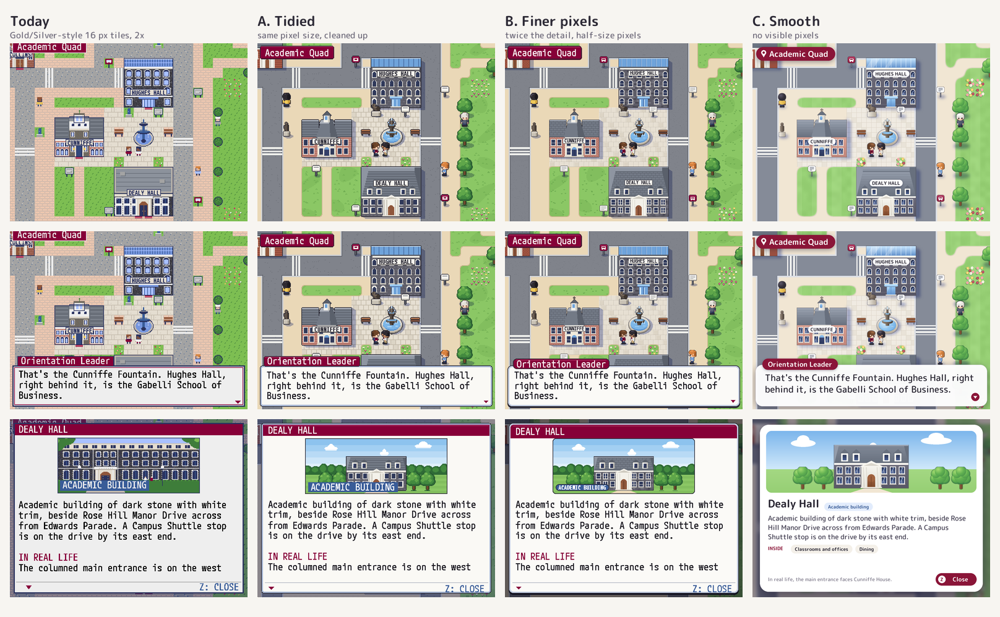
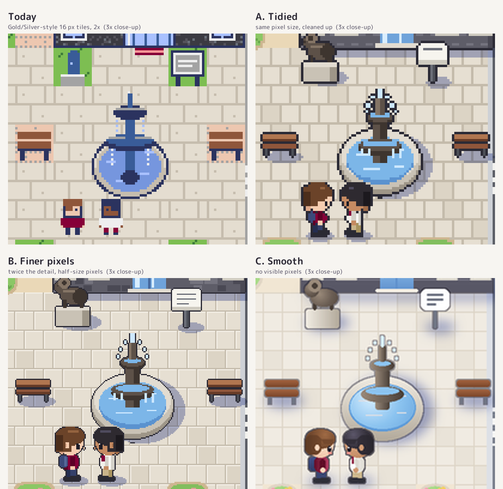
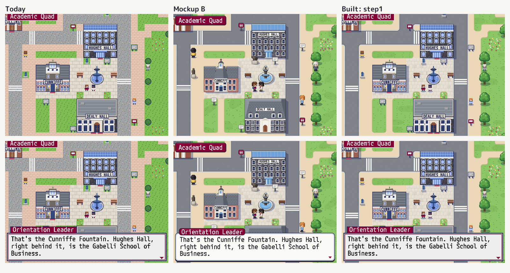
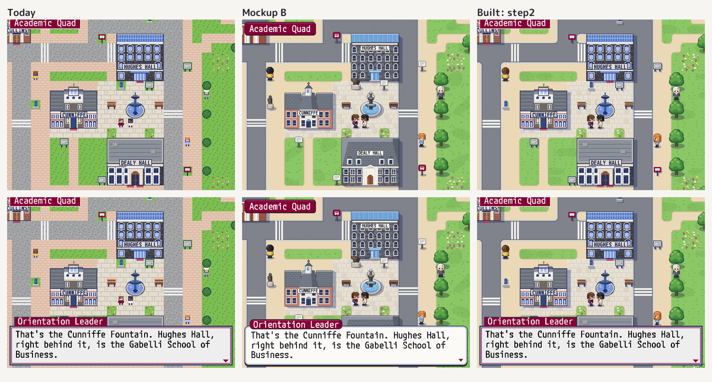
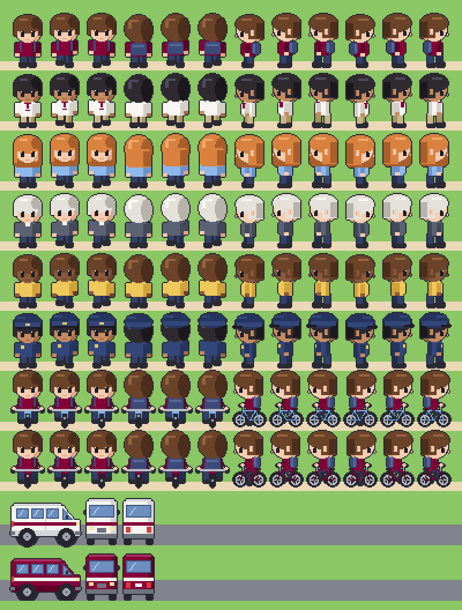
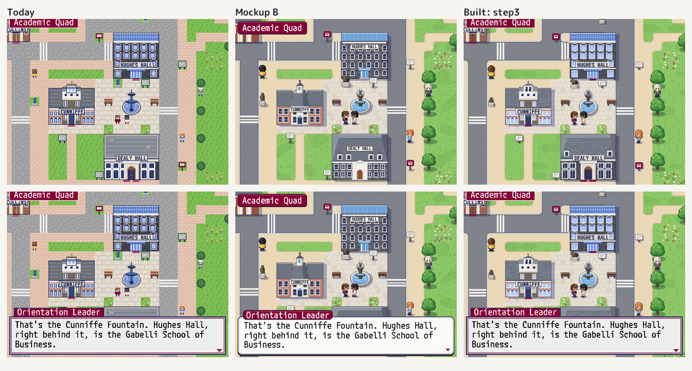
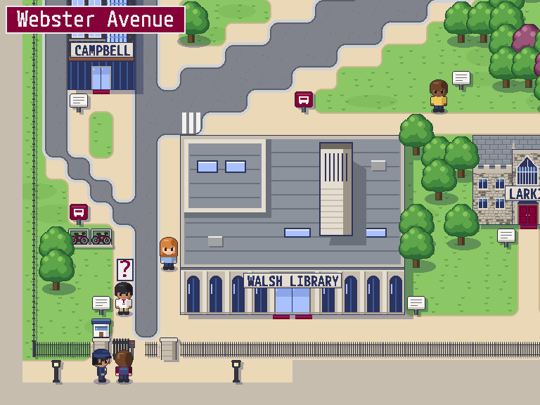
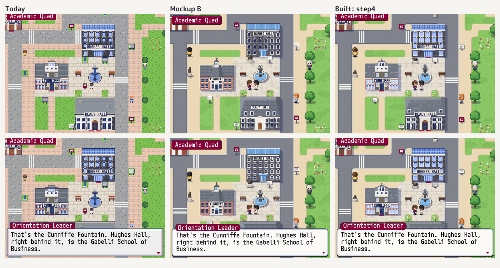
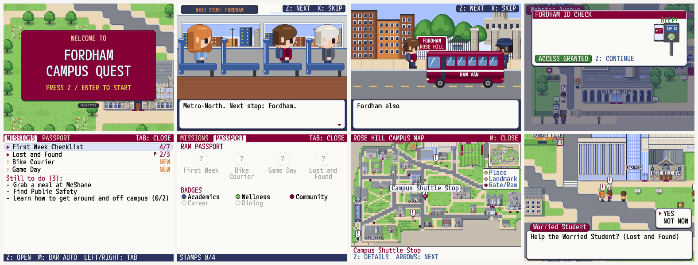

# D-0045: A cleaner, less pixelated look

| | |
|---|---|
| **Status** | Decided 2026-10-19: Option B approved, with everything in "What comes with A and B". Built on branch `finer-pixels` (from `campus-shuttle`) and checked on an iPhone |
| **Raised** | 2026-10-19. Version 1 looks like the original Pokémon Blue / Gold games; the next version should look cleaner and a little less pixelated |
| **Affects** | All art (ground, trees, people, vehicles, buildings, card pictures), the text boxes, cards and menus, and how the screen is drawn (`game/gfx/display.py`). Not the maps, content, missions, saving, web build or Campus Guide |
| **Built?** | Yes, all five steps, on branch `finer-pixels`. Checked on an iPhone. See "What was built" at the end |

## What's being decided

How far to move from today's Game Boy Color look, and whether that means a rewrite.

Today the art is 16 px tiles shown at 2×, with speckled grass, paths and roads, 16 × 16 people and 26 colours. Since D-0038 the text is drawn at full screen resolution (768 × 576) but the art isn't, so fine letters sit next to chunky art.

I've drawn the same spot, the Cunniffe Fountain plaza, in three styles, from small to large changes:

- **A. Tidied.** Same pixel size as today, with cleaner art (Pokémon FireRed / Emerald, Game Boy Advance era).
- **B. Finer pixels.** The same cleaner art at twice the detail, so each pixel is half as big. Still pixel art, but it looks smooth from a normal distance.
- **C. Smooth.** No visible pixels: gradients, soft shadows, rounded see-through boxes. Like a modern mobile game.

## The mockups

All pictures are in `decisions/images/0045/`. **Start with `overview.png`, then `closeups.png`.**

| Picture | What it shows |
|---|---|
| `overview.png` | All four looks side by side (today, A, B, C): the plaza, a conversation, and Dealy Hall's card. Half size |
| `closeups.png` | The fountain and the two people at 3× zoom in each look. This is where A and B differ most |
| `today_*.png` | **Real game screenshots**, taken with the mockups' camera, people and words |
| `A_*.png`, `B_*.png`, `C_*.png` | Each look at full size: `_overworld`, `_dialogue`, `_card` |

**What to keep in mind:**

- A, B and C are drawn by a script (`tools/style_mockups/`), not by the game. Only this corner of campus is drawn, and the buildings are quick sketches based on today's drawings, not traced from photos.
- A and B use the game's own font, drawn the way Pyxel draws it. C uses M PLUS Rounded 1c, a free font from the same family, which the game would have to add.
- C's card also changes the card's layout (a big title, "Inside" as tags, a Close button). A and B keep today's layout.

---

## Options

### What comes with A and B

These come with both pixel styles. If you'd rather not have one, say so in your notes.

- **No speckle textures.** Grass, paths and roads become flat colours with a few small details: grass tufts, paving slabs and kerbs.
- **Rounded lawn corners** where paths meet grass.
- **Shadows** under trees, people, signs and buildings, falling down and to the right. Each is one darker shade of whatever it lands on.
- **Outlines** round buildings, trees and people. The ground has none.
- **Taller people.** They're 22 px tall instead of 16, and their heads overlap the tile above, as in the Game Boy Advance games. They get faces, hair highlights and shading.
- **About 110 colours instead of 26.** Each material gets 3–4 shades. Pyxel allows about 255.
- **New frames** for the dialogue box, cards and the area banner: rounded, with a soft blue-grey rim.
- Small extras: the Ram statue becomes a ram, and Dealy Hall gets dormers.

### A. Tidied: same pixel size, cleaned up

- **Pros:**
  - The smallest change. The engine, screen and picture sizes all stay as they are.
  - Still unmistakably a Pokémon-style game.
  - Cheapest: redraw the art at today's sizes.
- **Cons:**
  - Still as pixelated as today. It's cleaner, not less pixelated, so it only half answers the brief.
  - Fine text next to chunky art stays a mismatch.

### B. Finer pixels: twice the detail (recommended)

The game still plays on 16 px cells. Every picture is drawn at twice the size (32 px tiles, people 32 × 44, Dealy Hall 192 × 160) and shown 1:1 on the 768 × 576 screen.

- **Pros:**
  - It's what "a little less pixelated, cleaner" means while staying a pixel game. Up close it's pixel art; at normal size it reads as clean drawing. Compare the B and Today close-ups.
  - Art and text finally share one resolution.
  - It stays in Pyxel: about 110 colours, and nothing Pyxel can't draw.
  - Room for detail: window frames, faces, paving, roof slates.
- **Cons:**
  - All art is redrawn at double size. Most of it is drawn by code already: the tiles in `placeholder_art.py`, and the buildings through `assets/buildings/_style/kit.py` and its draw scripts. So most of the work is upgrading that code, not drawing by hand.
  - The screen pipeline changes. The world would be drawn at full size instead of doubled. The map would be drawn once into one big picture (about 3,200 × 2,400 px), the way the plaque overlay is today.
  - Speed on phones needs checking again (D-0043). It should cost about the same as today, since today's art is already doubled up to full size every frame.

### C. Smooth: no visible pixels

- **Pros:**
  - The most modern and polished look, closest to an app.
  - Smooth, proportional text that fits more words per line.
- **Cons:**
  - **This one is a rewrite.** Pyxel can't draw it:
    - It has about 255 colours; the mockup uses about 26,000.
    - It can't blend one picture into another, so no soft shadows, smooth edges between overlapping things, or see-through boxes.
  - C means moving to a different engine, such as a browser game library (Phaser or PixiJS, in JavaScript) or Godot. That rewrites the 6,300 lines of game code, the tests and the web build. The maps and `content/` would carry over.
  - Illustrated art is slower to make and harder to keep consistent than pixel art.
  - It no longer looks like Pokémon, which has been the idea since D-0003 and D-0021.

## Rewrite or major revision?

**A or B is a major revision, not a rewrite.** The scenes, map files, content, missions, saving, web build, Campus Guide and accessibility work all stay. Only C needs a rewrite.

What B would touch:

| Area | Today | With B |
|---|---|---|
| Ground and object tiles | 49 tile types, 16 px, `game/gfx/placeholder_art.py` | Redrawn at 32 px with the new rules |
| People and vehicles | 6 people, 4 directions × 3 steps, the bike, 2 vans | Redrawn at 32 × 44 |
| Drawn buildings | 38 map pictures and 35 card pictures, from `kit.py` and the draw scripts | Kit and scripts upgraded to draw at 2× |
| Screen | Scenes drawn at 384 × 288 and doubled (`display.py`) | World drawn at full size; layout and gameplay unchanged |
| Boxes and menus | Text box, card, menus, campus map, title, intro | New frames; same layout and text |
| Colours | 26 | About 110 |

## How B would be built, if approved

One branch per step, each with screenshots for review (the same way as D-0023 to D-0025):

1. **Kit and screen:** the palette, ground, trees, shadows and full-size drawing. The whole map in the new ground, with today's buildings scaled up for now.
2. **People and vehicles.**
3. **Buildings:** the fountain plaza first (Hughes, Cunniffe, Dealy, Collins and the fountain), then athletics, residence halls and academic buildings in batches.
4. **Screens:** dialogue, cards and their pictures, menus, campus map, title and intro.
5. **Checks:** tests, the capture screenshots, the web build, and speed on a real phone.

## My recommendation

**Option B.** It's the version that's actually less pixelated, it keeps the Pokémon feel the game is built around, and it stays in Pyxel. That makes it a big art job, not a rewrite. It also fixes the mismatch between fine text and chunky art that D-0038 left. A is the fallback if B costs too much. I'd only choose C if the game should stop looking like a Pokémon game, because it means starting the engine again.

## Your decision

- [x] **Approve**: go with Option B
- [ ] **Not approve**: say which option you'd prefer, or why
- [ ] **Other**: describe below

If you approve, say if any item in "What comes with A and B" should be left out (the taller people, for example), and if any building should come first.

**Your notes:**

>

## What was built

### Step 1: the ground, trees and shadows (branch `finer-pixels`)

`step1_overworld.png`, `step1_dialogue.png` and `step1_card.png` are real screenshots from the game, taken the same way as the `today_*` ones.

- **The world is drawn at twice the detail.**
  - When the campus loads, the whole map is drawn once into one picture with 32 px cells (3,200 × 2,432 px).
  - Each frame the part on screen is copied straight onto the full 768 × 576 screen, so the world's pixels are now the same size as the text's.
  - Gameplay still runs on 16 px cells. Nothing about walking, the map files or the content changed.
- **The ground** (`game/gfx/world_art.py`; `game/world/ground.py` says what goes where):
  - lawns with soft patches and grass tufts
  - walkways with a darker edging where they meet a lawn
  - stone plazas in slabs
  - roads with kerbs, crosswalks and parking
  - flower beds
- **Rounded corners.** Lawns and walkways round their corners, and so do roads, with the kerb following the curve. Walkways and roads drawn as staircases on the map join up into smooth winding paths and roads.
- **Trees** are in the new style and drawn each frame, sorted with the people, so a tree's crown covers anyone standing behind it. The copper beeches are purple.
- **Shadows** fall down and to the right from buildings, trees, signs, lamps and benches. People and vans now have shadows too. A shadow is one darker shade of whatever it lands on.
- **Not redrawn yet** (steps 2 to 4):
  - Today's buildings, signs, benches, lamps, people and vans are shown doubled.
  - The text boxes, cards and menus are unchanged.
  - Fields and flat landmarks (the fountain, the parking lot) cast no shadow yet, because today's pictures of them include their own paving and turf.
- **Plaques** are lettered into the map picture at full detail, so people walking in front of them cover them naturally.
- **Colours:** 107, up from 26: the new ground and tree colours, plus a shadow shade for each. The 26 building colours keep their numbers, so the drawn buildings and `assets/buildings/palette.hex` are unchanged.
- **Speed:**
  - The map picture takes 0.08 s to draw on a laptop. In Chrome it takes 0.13 s, and 0.55 s with the CPU slowed 4× to act like a phone.
  - Walking stays at 30 frames a second. Drawing takes about 3.7 ms a frame in Chrome, and 15–20 ms with the CPU slowed 4×.
  - Add `?perf` to the page address to see the frame rate, with the map picture's time in the browser console.
- **Tests:**
  - `tests/test_ground.py` (12 tests) checks what stands on what, where corners round, edging and kerbs, staircase paths and roads joining up, and the palette.
  - `tests/test_display.py` checks that the campus is drawn in the new colours, with shadows and single-pixel detail.

### Step 2: people, the bike and the vans

- **People** (`game/gfx/people_art.py`) are redrawn at full detail for the six looks the game already uses, so no map or mission file changed:
  - the player
  - the Orientation Leader
  - the two students
  - the staff member
  - Public Safety
- **The new look:**
  - They stand 22 px tall instead of 16, so their heads rise into the cell above, as in the Game Boy Advance games.
  - They have faces with a glint in the eyes, hair with a highlight, and shading on the side away from the light.
  - Small details: the player's backpack, the Orientation Leader's maroon lanyard, the staff member's collar, and the officers' peaked caps and badges.
  - One student has long hair.
- **Walking** has two steps each way, with the legs, arms and a little bob changing.
- **The bike** has the rider sitting on it, pedals turning, in all four directions. Side on you see both wheels and the frame; from the front and back the wheel is end-on under the handlebars. It comes in both colours, light blue and the maroon one from the Bike Courier mission.
- **The vans** are the white Campus Shuttle with its maroon stripe and the maroon Ram Van with a white one. Each is drawn side on, from the front and from the back, with windows, wheels, lights and bumpers. They're the same size and in the same place as before.
- **Outlines:** everything on the sheet gets one dark outline in a single pass.
- **Mission markers:** the "!" and "?" over people's heads sit higher, above the taller heads.
- **Not changed yet:**
  - The intro (train, station, street) still uses today's characters. It's restyled in step 4 with the other screens.
  - The 1× fallback and the gallery tools still use today's sheet.
- **Tests:** `tests/test_display.py` checks that:
  - every frame is drawn and outlined, with room round its edges
  - right-facing frames mirror the left-facing ones, and the steps differ from standing
  - both vans have their colours
  - the campus shows the new people

### Step 3: buildings, signs, the fence and everything else on the map

- **All 38 drawn buildings** now have a second picture at twice the detail, `map_fine.png`, beside their `map.png`.
  - Each building's picture already comes from a drawing script, and I checked that all 38 scripts still draw exactly today's pictures. Two had a small bug from D-0022 that stopped them running; both are fixed.
  - `assets/buildings/_style/fine.py` runs the same scripts again at twice the size, with finer versions of the shared pieces: fieldstone, cut stone, brick, slate and flat roofs, windows (two panes, a glint, a sill), panelled doors, eaves, trees and parked cars.
  - Outlines are thinned to 1 px, and lawns and walkways inside a picture use the new colours.
  - Every building keeps its design. Only the drawing is finer.
- **The fountain plaza is finished by hand** (`_style/fine_plaza.py`) in the mockup's look:
  - Dealy Hall has a hipped slate roof with dormers and finer windows.
  - Cunniffe House has slate wing roofs and a finer cupola.
  - The fountain is dark bronze in a stone basin, with the plaza paving showing all round it.
- **Everything else on the map** is redrawn too (`game/gfx/object_art.py`):
  - info signs, Campus Shuttle stops, lamps, benches, statues (the one by the fountain is now the bronze Ram), the Victory Bell, graves, the observatory, guard booths, gate pillars, card readers, the closed gate, the bike rack, and the mission items
  - **the campus fence:** light iron railings that join up along their length and turn corners
  - **Faculty Memorial Hall,** the one building still made of tiles: slate roof, stone walls, panelled door
- **Plaques and door mats** are drawn at full detail: thin borders, sharp lettering.
- **Shadows:** everything casts one in its own shape. The fountain casts a low one.
- **Kept for now:** `map.png` stays as it is, for the in-game campus map and the 1× fallback. The building cards still use today's pictures, until step 4.
- **When a building changes:** run `uv run python assets/buildings/_style/fine.py <id>` after its own drawing script. The tests fail if a building has no `map_fine.png` or it's the wrong size.

### Step 4: the screens

- **Boxes, as in the mockup** (`game/ui/frames.py`):
  - rounded corners, a thin dark rim, a light blue-grey frame and a soft drop
  - the speaker's name on a maroon tab
  - banners, the mission bar and messages as rounded bars
  - the "!", "?" and BEEP as small speech bubbles with tails
  - a finer checker to dim the world behind cards and menus

  They're drawn at full detail, under each screen's words and icons.
- **Cards:**
  - All 35 card pictures now have a finer version, `card_fine.png`, made from their scripts like the map pictures, with round trees, finer stone and windows, and soft clouds.
  - The card has a rounded frame with a maroon heading, the picture in a dark rim, and the kind of place on a rounded tag.
- **Menus:** the Mission Log, a mission's page and the Ram Passport have a rounded tab, a soft highlight on the chosen mission, and stamps and badges as round discs at full detail.
- **The ID check:** a rounded panel, and the card, the phone and the reader redrawn at full detail, with "FORDHAM" and "TAP ID" lettered sharp.
- **The How to Play card** has key names on rounded blue chips.
- **The campus map:**
  - It's made from the new world, so it has the new colours, roads and lawns.
  - It has round pins, a pin with a name tag for the chosen place, a round "you are here" marker, and a key with round dots.
  - It's still shown at today's size (4 px a cell, doubled). Making it from the new world at full detail would take seconds on a phone, so it's halved first and then averaged as before, which costs the same as today.
- **The title** shows the campus in the new look behind a rounded maroon panel, slowly panning across Edwards Parade and Keating Hall. The campus picture is made here once and kept for the walk.
- **The intro** (the train, Fordham station, Webster Avenue) is drawn straight at full detail. It keeps the same layout and timing, with outlines, shading and finer windows. People are drawn at close-up size from the same drawing as on campus, not blown up, so the 2× and 3× close-ups from D-0019 stay sharp.
- **Tests:**
  - every card picture has a finer one
  - a box is rounded, rimmed and under the words
  - the intro shows the new people at full detail

  422 tests pass.

### Step 5: checks

- **Tests:** 422 pass. They check the ground, the palette, the people, the things on the map, the buildings' finer pictures, the cards, the boxes and the intro.
- **The capture screenshots** (`tools/capture.py`) run from the train to the passport stamp without errors.
- **The 1× fallback** still runs from the title through the intro to the campus.
- **The web build** is 3.2 MB.
- **Speed in Chrome:** about 30 frames a second on every screen at normal speed and with the CPU slowed 4×. Drawing takes 2 to 5 ms a frame at normal speed and about 9 ms slowed. The campus picture is built while the title shows, in about 0.1 s (0.3 s slowed).
- **On a real iPhone** (2026-10-19), checked by you: it looks good.

**Possible next steps:**
- check it on an Android phone
- hand-finish more buildings, as the fountain plaza was
- show the campus map at full detail, if a fast enough way turns up
